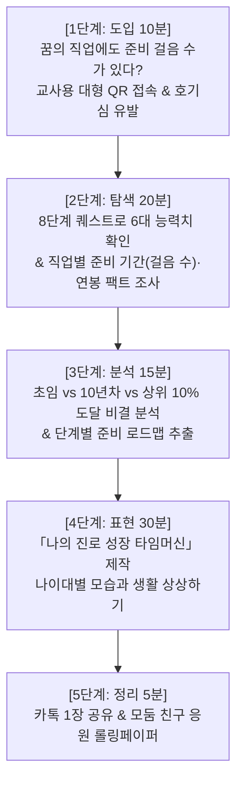

# [초등 진로 심화 수업 지도안 & 활동지] 내일찾기 단계별 준비로 만드는 「나의 진로 성장 타임머신」

> **수업 주제**: **"내일찾기 데이터로 그리는 단계별 준비 과정과 미래의 나의 모습"**  
> **과목**: 초등학교 5~6학년 실과 (나의 진로와 직업 탐색) / 창의적 체험활동 (진로활동)  
> **차시**: 2차시 블록타임 (80~90분)  
> **핵심 테마**: 단순한 장래희망 적기를 넘어, **초등(현재) → 중·고등(탐색) → 20대(첫걸음·초봉) → 30대(10년차 숙련기) → 40대+(상위 10% 마스터기)**로 이어지는 **단계별 준비 과정과 그 시기별 나의 생생한 모습**을 스토리텔링으로 설계하는 수업

---

## 🧭 [Part 1] 교수·학습 과정안 (지도안)

### 1. 수업 기획 의도 및 배경
* 초등학생들의 진로 교육은 "어른이 되면 OO가 될래요"라는 단편적인 결과 중심에 머물기 쉽습니다.
* 본 수업은 '내일찾기' 플랫폼의 **현실 데이터(준비 걸음 수, 필수 자격·학위, 초봉, 10년차 연봉, 상위 10% 도달 비결, 현실 고충)**를 바탕으로, **"그 꿈을 이루기 위해 각 나이대별로 거쳐야 하는 구체적인 준비 단계와 그 단계 속에서 내가 경험하고 성장하는 모습"**을 입체적으로 상상하여 표현하도록 돕습니다.

### 2. 학습 목표
1. **[데이터 탐색]** '내일찾기' 8단계 퀘스트와 110개 직업 도감을 통해 관심 직업의 **준비 걸음 수, 필요 학위/자격, 초봉·10년차·상위10% 소득, 현실적 고충**을 조사할 수 있다.
2. **[단계별 설계]** 조사한 데이터를 기반으로 **① 초등(씨앗기) ② 중·고등(성장기) ③ 20대(첫걸음기) ④ 30대(숙련기) ⑤ 40대+(마스터기)**의 5단계 준비 과정과 각 단계별 나의 모습을 구체적으로 기술할 수 있다.
3. **[공유 및 성찰]** '나의 진로 성장 타임머신 병풍 책(또는 4컷 성장 웹툰 카드)'을 만들어 친구들과 교환하고 서로의 성장을 응원할 수 있다.

---

### 3. 수업 흐름도 (80분 블록타임)



---

### 4. 차시별 교수·학습 과정 상세

| 단계 | 시간 | 주요 교수·학습 활동 및 내용 | 교사 지도 팁 및 자료 |
| :---: | :---: | :--- | :--- |
| **도입** | 10분 | **준비 단계(걸음 수)의 비밀 열기**<br>· 교사: *"어떤 직업은 1걸음(단기 준비)이면 시작할 수 있고, 도선사나 의사는 11~20걸음의 긴 준비가 필요해요. 왜 그럴까요?"*<br>· 교사용 칠판에 `[📱 QR 접속]` 화면을 띄워 학생 태블릿/스마트폰 스캔 유도<br>· 로그인 없이 바로 시작되는 8단계 퀘스트 입장 | · 빔프로젝터 QR 코드<br>· "꿈은 결과가 아니라 계단을 밟아가는 여행" 관점 전달 |
| **탐색** | 20분 | **8단계 퀘스트 & 6대 육각형 능력치 확인**<br>· 학생: Q1(과목 흥미)부터 Q7(5단계 기술/도전 선택)까지 솔직 체크<br>· Q8에서 나만의 멋진 칭호 직접 키보드 입력<br>· 결과창에서 나의 **육각형 6대 능력치**(창의, 논리, 테크, 끈기, 도전, 소통) 확인<br>· [활동지 1]에 나의 1위·2위 강점과 진로 칭호 기록 | · 활동지 Part 1<br>· 모던 클린 화이트 테마로 시인성 높게 확인 |
| **분석** | 15분 | **직업 도감 팩트체크: 준비 단계와 소득의 변화**<br>· 내가 찜한 직업 카드 클릭 → 5대 현실 Q&A 팩트시트 확인<br>  ① **준비 걸음 수와 필수 자격/학위** (몇 년이 걸리는가?)<br>  ② **초임 연봉** (사회 첫발을 내디뎠을 때의 소득과 월급)<br>  ③ **10년차 연봉** (일이 익숙해진 베테랑이 되었을 때)<br>  ④ **상위 10% 도달 비결** (최고수가 되기 위한 결정적 노력)<br>  ⑤ **현실적 고충(리스크)** (그 과정에서 견뎌야 할 힘든 점) | · 활동지 Part 2<br>· 고난과 리스크를 미리 알고 준비하는 성숙한 진로 태도 함양 |
| **표현** | 30분 | **「나의 진로 성장 타임머신」 5단계 모습 작성**<br>· 활동지 3의 5단계 양식에 맞춰 각 나이대별 **나의 구체적인 모습과 생활**을 상상하여 글과 그림으로 표현<br>  - [1단계: 지금 12~13세 초등] 나의 작은 실천과 배움<br>  - [2단계: 10대 중·후반 청소년] 실력을 갈고닦는 도전과 고민<br>  - [3단계: 20대 초·중반 청년] 사회 첫 출근, 첫 월급, 서툴지만 당찬 모습<br>  - [4단계: 30대 안정기] 10년 차 베테랑, 팀을 이끌고 가정을 꾸리는 모습<br>  - [5단계: 40대+ 최고수기] 상위 10% 도달 비결을 실천하여 세상에 기여하는 모습 | · 활동지 Part 3, 4<br>· 색연필, 사인펜으로 명함 및 타임머신 일러스트 채색 |
| **정리** | 5분 | **1장 모바일 카드 공유 및 상호 피드백**<br>· 내일찾기 화면의 `[카톡에 그림 바로 붙여넣기]` 기능을 사용해 학급 패들렛/게시판에 그림 파일 전송<br>· 짝꿍과 타임머신 활동지를 교환하고 "너의 30대 모습이 정말 멋지다!", "초등 실천 약속 응원해!" 칭찬 스티커 붙이기 | · 상호 칭찬 및 가족 대화 과제 제시 |

---

## 📝 [Part 2] 학생용 활동지 (Worksheet 세트 - 인쇄용)

> **[학습지] 내일찾기 데이터로 만드는 「나의 진로 성장 타임머신」**  
> **(   )학년 (   )반 (   )번  이름: _______________**

---

### [활동 1] 나의 출발선: 진로 캐릭터 등록증
1. 나의 진로 성향 코드: `[       -       -       ]`
2. 내가 정한 나의 미래 칭호: **" __________________________________________________ "**
3. 내일찾기 결과창에서 확인한 나의 **1위 강점**과 **2위 강점**:
   * 🥇 1위 슈퍼파워: _____________________ (      점)
   * 🥈 2위 슈퍼파워: _____________________ (      점)

---

### [활동 2] 내가 찜한 직업의 진짜 현실 데이터 수집
* 내가 탐색한 꿈의 직업: **[ 아이콘: (      )  직업명: ____________________ ]**
1. **준비 걸음 수와 필요 조건**:
   * 준비 걸음 수 뱃지: **(                   )** (예: 6걸음, 11걸음 등)
   * 필요한 필수 자격증 또는 학위: _________________________________________________
2. **소득(연봉)의 단계별 성장**:
   * **초임 연봉 (시작 단계)**: 약 **(                )**만 원 (월 실수령액 약 ______만 원)
   * **10년차 연봉 (숙련 단계)**: 약 **(                )**만 원
   * **상위 10% 연봉 (최고수 단계)**: 약 **(                )**만 원
3. **💡 상위 10% 최고수가 되는 현실적 비결**:
   > _________________________________________________________________________________
4. **⚠️ 이 직업을 준비하고 일하면서 견뎌내야 할 현실적 고충(리스크)**:
   > _________________________________________________________________________________

---

### [활동 3] 「나의 진로 성장 타임머신」 단계별 준비와 나의 모습

* 아래의 5단계를 거치며 성장해가는 나의 모습을 시간 순서대로 생생하게 적어보세요!

#### 🚀 1단계: [현재 12~13세] 호기심의 씨앗을 심는 초등학생 나
* **이 시기 나의 모습**: ___________________________________________________________
* **지금 내가 꼭 실천할 3가지 행동**:
  * 📚 **추천 교과목 공부**: ____________________________________________________
  * 🏫 **학교/방과후 활동**: ____________________________________________________
  * 💻 **지금 당장 해볼 수 있는 무료 체험 툴**: __________________________________

#### 🔍 2단계: [10대 중·후반] 방황과 도전을 겪으며 실력을 쌓는 청소년 나
* **진학하고 싶은 고등학교 또는 동아리**: _________________________________________
* **이 시기 내가 겪을 수 있는 어려움과 그것을 극복하는 나의 모습**:
  > _________________________________________________________________________________

#### 💼 3단계: [20대 초·중반] 사회에 첫발을 내딛는 당찬 청년 나 (초봉 단계)
* **내가 취득한 자격증/면허 또는 전공**: _________________________________________
* **나의 첫 직장(일터)과 첫 출근 날 나의 모습**:
  > _________________________________________________________________________________
* **예상 초임 연봉 (        )만 원! 첫 월급을 타서 가장 먼저 하고 싶은 일**:
  > _________________________________________________________________________________

#### 🏆 4단계: [30대] 10년 차 베테랑으로 우뚝 선 프로페셔널 나 (10년차 연봉 단계)
* **일터에서 나의 직급/역할과 능숙하게 일하는 나의 하루 풍경**:
  > _________________________________________________________________________________
* **10년 동안 일하며 내가 이뤄낸 가장 자랑스러운 성취**:
  > _________________________________________________________________________________
* **나의 생활 터전과 라이프스타일 (서울 or 지방 거점, 내 집 마련, 취미 등)**:
  > _________________________________________________________________________________

#### 👑 5단계: [40대 이후] 상위 10% 마스터로 세상에 기여하는 나 (최고수 단계)
* **내일찾기 상위 10% 비결을 실천한 나의 결정적 성공 비결**:
  > _________________________________________________________________________________
* **내가 고객, 환자, 또는 사회에 선물하고 있는 소중한 가치**:
  > _________________________________________________________________________________
* **과거 초등학생 시절의 나에게 보내는 한 줄 격려 메시지**:
  > " _____________________________________________________________________________ "

---

### [활동 4] 미래의 나를 증명하는 [2036 미래 신분증 & 명함] 제작

```
┌────────────────────────────────────────────────────────────────────────┐
│  [2036 미래 전문가 명함 앞면]                                         │
│                                                                        │
│   소속 기관 / 회사: _________________________________________          │
│   공식 직함 / 역할: _________________________________________          │
│                                                                        │
│   【 나의 칭호 】: __________________________________________          │
│   【 성       명 】: ___________________ (서명 또는 도장)              │
│                                                                        │
│   나의 핵심 슬로건: " _____________________________________________ "  │
│                                                                        │
└────────────────────────────────────────────────────────────────────────┘

┌────────────────────────────────────────────────────────────────────────┐
│  [2036 미래 전문가 명함 뒷면]                                         │
│                                                                        │
│   📊 나의 핵심 역량: 1위 [               ]  /  2위 [                ]  │
│   🎯 준비 기간: (      )년의 치열한 배움을 거쳐 전문성을 완성함        │
│   💰 10년 차 달성 연봉: 연 (                  )만 원                   │
│                                                                        │
│   🌟 내가 꿈꾸는 사회적 기여:                                          │
│      " ____________________________________________________________ "  │
│                                                                        │
└────────────────────────────────────────────────────────────────────────┘
```

---

## 🌟 [Part 3] 학생 예시 작성본 (교사용 지도 모델 2종)

### 📌 예시 모델 1: 기술·공학 계열 (초등 6학년 남학생 가상 작성본)
* **직업**: 반도체·AI 칩 엔지니어 (수도권 남부 테크밸리 근무)
* **칭호**: `미래 문명을 가동하는 나노 AI 칩 설계자`
* **단계별 모습**:
  * **1단계 (초등 6학년, 현재)**: "수학 분수와 소수 연산 기초를 튼튼히 하고, 방과후 로봇 코딩반에서 센서 제어를 배운다. 내일찾기에서 추천해준 무료 툴 Tinkercad Circuits로 방구석에서 가상 회로를 만들어본다."
  * **2단계 (중·고교 시절)**: "과학고나 마이스터고 진학을 고민하며 파이썬 코딩과 물리 과목에 몰입한다. 어려운 수학 문제에 막혀 좌절할 때도 있지만, 끈기력 스탯을 발휘해 끝까지 답을 찾아낸다."
  * **3단계 (20대 중반, 사회 첫걸음)**: "전자공학과 학사와 석사를 마치고 대기업 반도체 연구소에 신입 엔지니어로 입사한다. 초봉 5,800만 원(월 세후 약 400만 원)을 받는다. 첫 월급으로 부모님께 안마기를 사드리고 나머지는 청년도약계좌에 저축한다. 클린룸에서 방진복을 입고 하루 1만 보를 걸으며 라인 장애를 해결하느라 피곤하지만 기술을 배운다는 자부심이 크다."
  * **4단계 (30대 중반, 10년 차 안정기)**: "10년 차 수석 엔지니어가 되어 연봉 1억 1,000만 원을 달성한다. 차세대 온디바이스 AI 칩 설계 프로젝트 팀장으로 후배들을 이끈다. 회사 근처 동탄 신도시에 30평 아파트를 마련하여 퇴근 후 저녁이 있는 삶을 누린다."
  * **5단계 (40대 이후, 상위 10% 마스터)**: "내일찾기 비결대로 'HBM 차세대 3차원 패키징 특허'를 등록하여 상위 10% 펠로우(Fellow)로 임명되어 연봉 2억 2,000만 원을 받는다. 전 세계 인공지능이 내가 설계한 칩으로 작동하는 모습을 보며 전율을 느낀다."

---

### 📌 예시 모델 2: 인문·창작 계열 (초등 5학년 여학생 가상 작성본)
* **직업**: 웹소설·스토리 크리에이터 (디지털 프리랜서)
* **칭호**: `1억 독자의 가슴을 뛰게 하는 마스터 스토리텔러`
* **단계별 모습**:
  * **1단계 (초등 5학년, 현재)**: "국어와 역사책을 열심히 읽고 매일 밤 짧은 상상 일기를 쓴다. 내일찾기 액션플랜 추천대로 무료 메모 앱 노션(Notion)에 나만의 캐릭터 설정집과 세계관 노트를 비밀리에 정리한다."
  * **2단계 (중·고교 시절)**: "청소년 문학 공모전에 도전하고 웹소설 동아리를 만들어 친구들과 서로의 습작을 피드백해준다. 악플을 받거나 슬럼프가 와서 글이 안 써질 때도 있지만, 산책을 하며 멘탈을 회복한다."
  * **3단계 (20대 초반, 첫 연재 데뷔)**: "대학 문예창작과에 다니며 문피아/시리즈 플랫폼에 첫 유료 연재를 시작한다. 초기 순익은 연 2,400만 원으로 소박하지만, 내 글에 달린 독자들의 '다음 화 빨리 올려주세요!' 댓글을 보며 밤새 행복하게 타이핑한다."
  * **4단계 (30대, 10년 차 안정기)**: "안정기 연봉 7,500만 원에 도달한다. 내 소설 중 한 편이 드라마화 판권 계약을 맺는다. 집에서 편안하게 일하며 하루 4시간 글을 쓰고, 오후에는 카페에서 커피를 마시며 다음 작품을 구상하는 워라밸을 누린다."
  * **5단계 (40대 이후, 상위 10% 고수)**: "누적 뷰 수 5,000만 뷰를 넘어서며 글로벌 웹툰 원작자로 도약해 상위 10% 연봉 3억 5,000만 원을 달성한다. 지치고 힘든 현대인들에게 상상력과 따뜻한 위로를 선물하는 대한민국 대표 작가가 된다."

---

## 💡 [Part 4] 교사의 단계별 피드백 및 발문 가이드

1. **"준비 기간(걸음 수)이 긴 직업"을 고른 학생 지도**:
   * 의사(11걸음), 판사(8걸음), 도선사(20걸음)처럼 준비 기간이 긴 직업을 선택한 학생에게는:
   * **교사 발문**: *"이 직업은 20대에도 계속 공부하고 훈련해야 하는 긴 호흡이 필요해. 20대 수련 시기에 포기하지 않으려면 지금 초등학교 때 어떤 '끈기 습관'을 들여야 할까?"*
2. **"초봉과 10년차 연봉 격차" 지도**:
   * 시작은 작지만 실력이 쌓일수록 폭발하는 직업(프리랜서, 자영업, 테크)과, 시작부터 안정적인 직업(공무원, 대기업)의 차이를 설명하고, 소득이 커질수록 따르는 **책임감의 무게**를 함께 생각해보게 합니다.
3. **가정 연계 활동 (학부모 상담 자료)**:
   * 활동지 4의 **[2036 미래 신분증 & 명함]**을 완성한 후, 집으로 가져가 부모님께 명함을 건네며 *"엄마, 제가 30대가 되면 이 연봉을 받고 이런 준비를 거쳐 멋진 사람이 될게요!"*라고 대화하도록 지도합니다.
