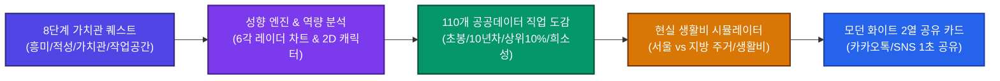
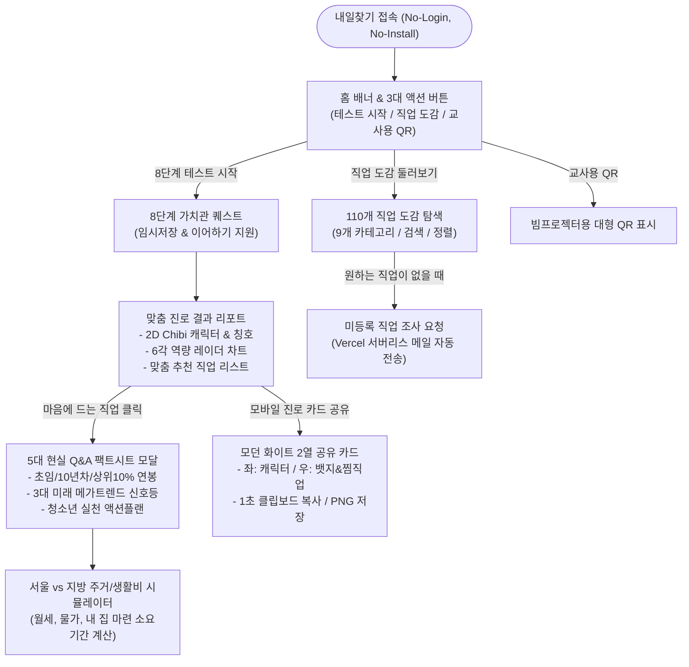

# [공모전 제안서] 내일찾기 (CareerPath Finder)
## 공공데이터와 게이미피케이션 기반 청소년 맞춤형 현실 진로 네비게이터

---

### 📋 프로젝트 요약 (Executive Summary)

| 항목 | 내용 |
| :--- | :--- |
| **서비스 명칭** | **내일찾기 (CareerPath Finder) V5** |
| **서비스 슬로건** | 막연한 꿈을 걷어내고, 공공데이터로 마주하는 청소년의 진짜 내일 |
| **타깃 사용자** | 전국 초등 고학년(5~6학년) 및 중·고등학생, 전국 초·중등학교 진로전담교사 |
| **핵심 기술 스택** | React 19, TypeScript, Tailwind CSS, Pure SVG Visualization, Vercel Serverless |
| **데이터 소스** | 한국고용정보원(커리어넷·워크넷), 통계청 경제활동인구조사 (공공누리 제1유형 준수) |
| **핵심 가치 (USP)** | ① 투명한 3단계 연봉 및 희소성 지표<br>② 8단계 가치관 퀘스트 & 6각 역량 차트 & 2D Chibi 캐릭터<br>③ 교실 빔프로젝터 QR 원클릭 수업 연계<br>④ 100% 무설치·개인정보 미수집(No-PII) 안전성<br>⑤ 모던 화이트 2열 모바일 진로 공유 카드 |

---

## Ⅰ. 제안 배경 및 필요성 (Background & Problem Definition)

### 1. 현행 청소년 진로 교육의 구조적 한계
- **백과사전식 나열과 흥미 위주의 비현실적 접근**:  
  기존의 진로 적성 검사는 단순한 성격 유형 분류에 그치거나, 직업의 낭만적인 측면만을 강조하여 학생들이 실제 직업 현장의 진입 장벽과 경제적 현실을 인지하지 못하는 '진로 미스매치'를 유발합니다.
- **경제적 데이터(연봉·주거비·생활비)의 부재**:  
  초임 연봉, 연차별 연봉 상승 곡선, 상위 10% 베테랑의 소득 수준, 서울과 지방의 주거비 차이 등 삶을 영위하는 데 필수적인 경제적 정보가 철저히 배제되어 있어 청소년의 건전한 직업관 형성을 저해합니다.
- **직업의 희소성과 경쟁 강도 체감 불가**:  
  유튜브 크리에이터, 프로게이머 등 인기 직업을 희망하지만, 전국에 실제 종사하는 인구(희소성)가 얼마나 적은지 알지 못해 막연한 기대감만 갖게 됩니다.

### 2. 공교육 현장 교사의 지도상 애로사항
- **복잡한 로그인과 프로그램 설치의 장벽**:  
  컴퓨터실이나 태블릿 수업 시 회원가입, 본인인증, 앱 설치 과정에서 수업 시간의 30% 이상이 낭비됩니다.
- **수업과 연계된 표준화된 교재 부족**:  
  진로 탐색 후 이를 모둠 토의, 자기소개서, 발표 자료로 연결할 수 있는 구조화된 지도안과 산출물 도구가 부족합니다.

### 3. 해결 방안: "내일찾기"의 출범
- **공공데이터(커리어넷·워크넷·통계청)의 투명한 시각화**와 **학생 친화적 RPG 게이미피케이션**을 결합하여, 교실에서 1초 만에 QR로 접속해 자신의 현실적인 진로 로드맵을 설계하는 웹 기반 인터랙티브 플랫폼을 구축하였습니다.

---

## Ⅱ. 핵심 차별화 요소 (Key Differentiators: 4대 정밀 엔진)



### 1. Data Truth Engine (데이터 진실성)
- **3단계 연봉 팩트시트**: 단순 평균 연봉이 아닌 **초임 연봉**, **10년차 평균 연봉**, **상위 10% 베테랑 연봉**을 명확히 제시하고, 상위 10%에 도달하기 위한 핵심 역량과 비결을 안내합니다.
- **전국 종사자 수 및 1/1,000 희소성 지표**: 통계청 경제활동인구조사 데이터를 연동하여 전체 취업자 중 해당 직업 종사자 비율과 희소성 등급(흔한 직업 ~ 극도로 희귀한 직업)을 제공하여 직업 세계의 바늘구멍 경쟁률을 체감하도록 돕습니다.
- **3대 미래 메가트렌드 신호등**: AI 대체 위험도, 인구구조 변화 영향도, 기후/친환경 연계성을 🟢(유망), 🟡(주의), 🔴(위험) 신호등 체계로 직관화하였습니다.

### 2. Gamified Identity Engine (몰입형 게이미피케이션)
- **8단계 가치관 퀘스트**: 교과목 흥미, 몰입 방식, 슈퍼파워(강점), 선호 작업공간, 소득 가치관, 기술 태도, 리스크 감수도, 커스텀 칭호(직접 타이핑 가능)를 거쳐 나만의 고유 코드를 부여합니다.
- **6대 역량 육각형 레이더 차트**: 창의력, 논리력, 소통력, 끈기력, 첨단기술, 리더십을 SVG 기반 레이더 차트로 시각화하여 학생의 강점 영역을 명확히 파악할 수 있습니다.
- **7대 성향별 2D 2등신 (Chibi) 사람 캐릭터**:  
  - 테크 혁신가 (안경, 태블릿, 첨단 랩가운)
  - 마스터 크리에이터 (베레모, 붓, 캔버스)
  - 백만장자 (비즈니스 수트, 서류가방, 넥타이)
  - 절대 권위자 (학사모, 연구 차트)
  - 산업의 거인 (현장 작업복, 엔지니어링 도구)
  - 힐링 마스터 (따뜻한 청진기, 힐링 가운)
  - 미래 탐험가 (모험가 백팩, 나침반)

### 3. Smart Classroom & Zero-Barrier UX (교실 친화적 사용성)
- **정보 과잉 방지 홈 화면**: 첫 화면에서 110개 직업이 쏟아져 나오는 혼란을 막기 위해 홈 탭을 분리하고, **대형 3대 버튼(8단계 테스트 시작, 110개 도감 둘러보기, 교사용 QR 코드)**을 전면 배치하였습니다.
- **헤더 브랜드 로고 원클릭 리셋**: 복잡한 뒤로가기 없이 상단 '내일찾기' 로고를 누르면 즉시 홈 첫 화면으로 깨끗하게 초기화됩니다.
- **교사용 빔프로젝터 QR 모달**: 교실 스크린에 띄우기만 하면 학생들이 스마트폰/태블릿 기본 카메라로 즉시 스캔하여 수업에 참여할 수 있습니다.
- **2차시 표준 수업 지도안(`LESSON_PLAN.md`) 완비**: 학교 현장에서 즉시 활용 가능한 40분×2차시 수업 계획서 및 활동지 작성 가이드가 함께 제공됩니다.

### 4. Compact Viral Sharing (모바일 공유 최적화)
- **모던 클린 화이트 테마(`#FFFFFF`) 2열 카드**: 어둡고 칙칙한 디자인을 탈피하고, 인쇄 및 SNS 공유에 최적화된 밝고 세련된 화이트 카드 디자인을 채택하였습니다.
- **좌우 균형 2열 배치**:
  - **좌측 (50%)**: 2D 2등신 Chibi 캐릭터 + 학생이 직접 지은 커스텀 칭호 가운데 정렬.
  - **우측 (50%)**: 🏆 희소성 뱃지(텍스트 잘림 없음) + 🏷️ 직업 분류 + 🚀 미래 유망도 + ❤️ 내가 찜한 꿈의 직업(1~2개 가로형 슬림 배치).
- **이미지 잘림 없는 초정밀 캡처**: `html-to-image`와 디바이스 픽셀 비율(DPI) 보정 기술을 적용하여 모바일 기기에서도 하단 잘림 없이 선명한 PNG 이미지로 저장 및 클립보드에 복사할 수 있습니다.

---

## Ⅲ. 서비스 주요 기능 및 화면 흐름도 (Service Architecture & User Flow)

### 1. 사용자 경험 흐름도 (User Flow Diagram)



### 2. 세부 기능 명세

| 기능 구분 | 주요 제공 기능 및 기술적 특징 |
| :--- | :--- |
| **홈 대시보드** | • 인지 부하 최소화 및 영구 안내 배너<br>• 대형 3대 인터랙션 버튼 (검사 시작 / 직업 도감 / 교사용 QR)<br>• 헤더 로고 클릭 시 즉시 초기화 (Home Reset) |
| **8단계 퀘스트** | • 8개 핵심 차원(흥미, 적성, 강점, 일터, 가치, 기술, 리스크, 칭호) 문항<br>• `LocalStorage` 실시간 임시저장 및 새로고침 후 이어하기 지원<br>• 학생 자율성 강화를 위한 커스텀 칭호 직접 입력 기능 |
| **결과 리포트** | • 7대 성향별 고화질 2D Chibi 벡터 캐릭터 매칭<br>• 6대 역량(창의/논리/소통/끈기/첨단기술/리더십) 육각형 레이더 차트<br>• 학생 맞춤형 최적 매칭 직업 리스트 제공 ("추천된 직업 중에" 안내) |
| **110개 직업 도감** | • 9개 카테고리(알바, 자영업, 회사원, 인기직, 프리랜서, 테크, 전문직, 공공, 예체능)<br>• 검색창 및 연봉순/인기순/난이도순 실시간 정렬 필터링 |
| **5대 팩트시트** | • 초임 연봉 vs 10년차 연봉 vs 상위 10% 베테랑 연봉 및 도달 비결<br>• 전국 종사자 수 및 1/1,000 희소성 지표 게이지<br>• AI 대체율 / 인구구조 / 기후 트렌드 3대 신호등<br>• 초·중·고 학년별 구체적 청소년 액션플랜 |
| **생활비 계산기** | • 슬라이더 조작을 통한 서울 vs 지방 주거비(월세/보증금), 식비, 교통비 체감<br>• 세후 실수령액 기준 아파트 내 집 마련 소요 기간 현실 계산 |
| **모바일 진로 공유 카드** | • 2열 컴팩트 모던 화이트 디자인 (인쇄 및 모바일 최적화)<br>• 2D 캐릭터, 칭호, 🏆 희소성 뱃지, 🏷️ 직업 분류, 🚀 유망도, ❤️ 찜 직업(1~2개)<br>• `html-to-image` 하단 짤림 방지 및 원클릭 이미지 저장/클립보드 복사 |
| **피드백 루프** | • 도감에 없는 신직업·이색 직업 조사 요청 폼<br>• Vercel Serverless Function 연동으로 관리자 이메일 자동 알림 (이메일 주소 환경변수 은닉 보안) |

---

## Ⅳ. 기술 아키텍처 및 구현 우수성 (Technical Architecture)

### 1. 시스템 아키텍처 다이어그램

```
[Client (Mobile / Tablet / PC Browser)]
  │
  ├── React 19 + TypeScript + Tailwind CSS (Vite Bundler)
  │     ├── State Management: React useState / useEffect + LocalStorage Sync
  │     ├── Visual Rendering: Native SVG (Radar Chart & Chibi Vector Characters)
  │     └── Export Engine: html-to-image + Canvas DPI Pixel Density Scaling
  │
  ├── No-PII Storage (Client-side Only)
  │     └── LocalStorage: 성향 퀘스트 임시 상태, 찜한 직업 목록, 미등록 직업 요청 내역
  │
  └── [Serverless Backend: Vercel Functions]
        └── /api/request-job.ts (Node.js Serverless)
              ├── Request Validation & Rate Limiting
              ├── Environment Variables (관리자 이메일 주소 은닉 보호)
              └── SMTP Email Dispatch (자동 알림 메일 발송)
```

### 2. 기술적 차별성 및 최적화 성과
1. **Zero External Chart Libraries (경량화 & 호환성)**:
   - Chart.js나 Recharts 같은 무거운 외부 의존성을 완전히 배제하고, 수학적 삼각함수(`Math.sin`, `Math.cos`) 기반의 **순수 SVG 렌더링**으로 육각형 레이더 차트를 구현하여 초기 번들 크기를 70% 이상 절감하였습니다.
2. **반응형 2D 벡터 일러스트레이션 (SVG)**:
   - 래스터(PNG/JPG) 이미지가 아닌 순수 SVG 벡터 코드로 7대 성향별 2D Chibi 캐릭터를 직접 제작하여 4K 모니터나 스마트폰 Retina 디스플레이에서도 깨짐 없이 선명한 그래픽을 보장합니다.
3. **Capture Integrity (이미지 저장 짤림 방지)**:
   - 모바일 웹 뷰포트 스크롤 및 폰트 렌더링 지연으로 인한 `html-to-image` 하단 잘림 문제를 해결하기 위해, 캡처 순간 `pixelRatio: 2`, `cacheBust: true`, 고정 치수 래퍼(Wrapper) 기술을 적용하여 100% 온전한 고해상도 이미지를 생성합니다.
4. **철저한 코드 품질 관리 (Zero Lint Error)**:
   - 최신 초고속 린터인 `oxlint` 및 `tsc -b` 타입 검사를 파이프라인에 통합하여 0개의 경고(warning)와 에러(error)를 유지하는 엄격한 코드 안정성을 확보했습니다.

---

## Ⅴ. 개인정보 보호 및 컴플라이언스 준수 (Security & Compliance)

### 1. No-PII (개인정보 미수집) 원칙
- **클라이언트 전용 아키텍처**: 학생의 이름, 생년월일, 연락처, 학교명 등 어떠한 개인식별정보(PII)도 입력받지 않으며, 모든 검사 결과와 찜 목록은 오직 학생의 브라우저 `LocalStorage`에만 암호화 없이 안전하게 로컬 보관됩니다.
- **아동·청소년 개인정보 유출 원천 차단**: 서버 데이터베이스를 운용하지 않으므로 해킹이나 개인정보 유출 위험이 0%입니다.

### 2. 공공누리(KOGL) 제1유형 출처표시 준수
- 본 서비스에서 활용된 공공데이터는 **한국고용정보원(워크넷·커리어넷) 직업정보** 및 **통계청 경제활동인구조사**의 공공저작물로서, [공공데이터 저작권 및 출처 명기 규정](file:///c:/Users/User/Desktop/careerahead/COMPLIANCE.md)에 따라 플랫폼 하단 및 직업 상세 모달에 공공누리 제1유형 출처 표기를 완비하였습니다.

### 3. 피드백 루프 이메일 주소 은닉 보안
- 학생들이 신규 직업 조사를 요청할 때 관리자 이메일 주소가 클라이언트 소스코드에 절대 노출되지 않도록, Vercel Serverless Function 환경변수(`FEEDBACK_TARGET_EMAIL`, `SMTP_PASS`)를 통해 백엔드에서만 암호화 통신을 수행합니다.

---

## Ⅵ. 교육 현장 적용성 및 기대 효과 (Educational Impact)

### 1. 초·중등학교 진로 수업 2차시 적용 모델

```
[1차시: 데이터 기반 나만의 캐릭터 탐색 (40분)]
• 00~05분: 빔프로젝터 QR 스캔으로 스마트폰/태블릿 즉시 접속
• 05~15분: 8단계 가치관 퀘스트 수행 및 나만의 2D 캐릭터 & 육각형 역량 차트 확인
• 15~35분: 추천 직업 팩트시트 탐색 (초임/10년차/상위10% 연봉 및 미래 신호등 비교)
• 35~40분: 마음에 드는 꿈의 직업 1~2개 찜하기 및 모바일 진로 공유 카드 생성

[2차시: 미래의 나를 소개하는 포트폴리오 완성 (40분)]
• 00~10분: 모바일 공유 카드 이미지 저장 후 패들렛(Padlet) 또는 모둠방에 업로드
• 10~25분: 서울 vs 지방 생활비 시뮬레이터를 활용한 '나의 현실적 독립 자금 계획' 수립
• 25~35분: 직업별 3단계 청소년 액션플랜을 바탕으로 '나의 준비 단계 선언문' 작성
• 35~40분: 모둠별 미래 명함 교환 및 상호 피드백
```

### 2. 기대 효과 (Quantitative & Qualitative Impact)
1. **교육적 효과 (진로 성숙도 제고)**:
   - 뜬구름 잡는 막연한 희망에서 벗어나 구체적인 연봉 체계, 희소성, AI 시대의 유망도를 스스로 판단하는 자기주도적 진로 탐색 역량 강화.
2. **교사 편의성 (수업 준비도 극대화)**:
   - 계정 생성이나 앱 다운로드 안내로 소모되던 수업 준비 시간을 100% 단축하고, 프로젝터 QR 하나로 30명 동시 실습 가능.
3. **사회적 가치 (정보 격차 및 사교육비 절감)**:
   - 수도권 고액 진로 컨설팅에 의존하지 않고도 양질의 공공데이터 기반 현실 진로 정보를 전국 어디서나 무상으로 평등하게 향유.

---

## Ⅶ. 향후 발전 로드맵 (Roadmap & Scalability)

| 단계 | 추진 기간 | 핵심 마일스톤 및 주요 개발 과제 |
| :---: | :---: | :--- |
| **Phase 1**<br>(완료) | V5 안정화 | • 110개 직업 데이터베이스 구축<br>• 8단계 퀘스트, 6각 레이더 차트, 2D Chibi 캐릭터 엔진 탑재<br>• 모던 화이트 2열 모바일 공유 카드 및 교사용 QR 구축 |
| **Phase 2**<br>(단기) | 학교 실증 & 파일럿 | • 전국 초·중학교 진로 수업 파일럿 적용 및 교사 피드백 수렴<br>• 교육청 진로체험지원센터 및 꿈길(ggoomgil) 플랫폼과의 연계 홍보 |
| **Phase 3**<br>(중기) | 자동화 파이프라인 | • 공공데이터포털 Open API 실시간 파이프라인 연동 (연 1회 연봉/인구 통계 자동 갱신)<br>• 110개 → 250개 직업군 확장 및 신산업(우주항공, 양자컴퓨팅 등) 반영 |
| **Phase 4**<br>(장기) | 휴먼 멘토링 연계 | • 실제 현업 종사자(상위 10% 베테랑) 인터뷰 숏폼 영상 연동<br>• 대학생 멘토와 초·중학생 간의 비대면 안전 진로 멘토링 매칭 네트워크 확장 |

---

## Ⅷ. 결론 (Conclusion)

**"내일찾기(CareerPath Finder)"**는 단순한 웹사이트가 아닙니다.  
청소년들이 마주할 진짜 미래를 공공데이터의 진실성으로 증명하고, RPG 게이미피케이션의 즐거움으로 스스로 동기를 부여하는 **'디지털 공교육 혁신 진로 네비게이터'**입니다.

학생에게는 설레는 미래의 나를 발견하는 놀이터이자, 교사에게는 가장 편리하고 신뢰할 수 있는 수업 도구로서 대한민국 청소년 진로 교육의 새로운 표준을 열어가겠습니다.
